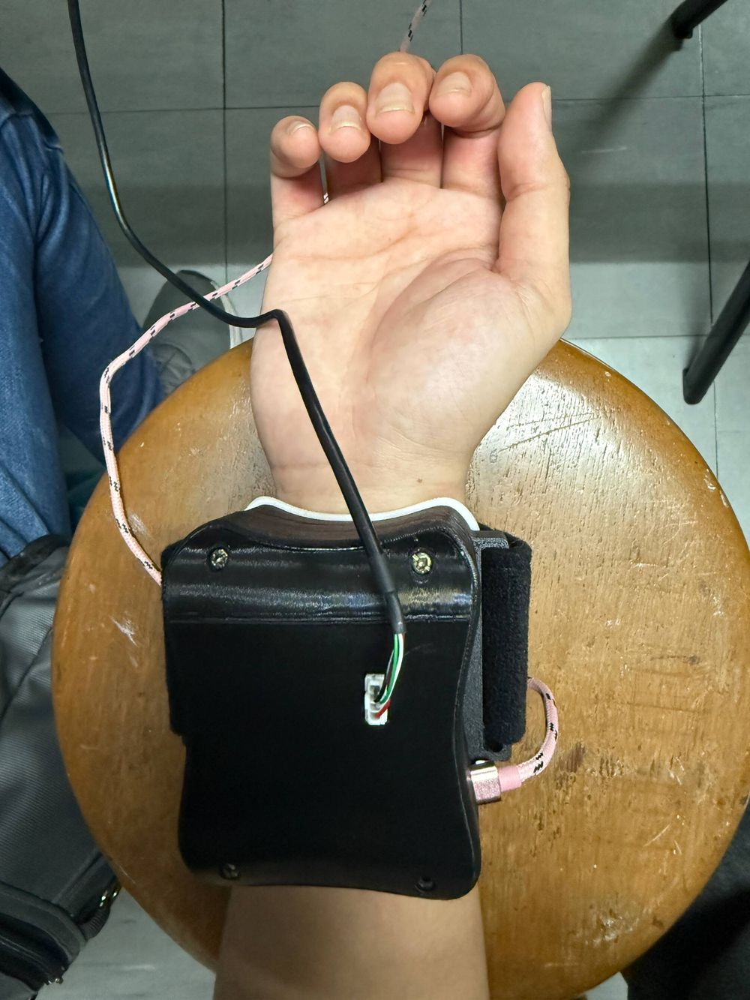

# GripVT

**A camera inside a forearm sensor watches 99 elastomer markers move, and a small model turns that motion into grip force.**

[](LICENSE)


<picture>
  <source media="(prefers-color-scheme: dark)" srcset="assets/gripvt-pipeline-dark.svg">
  
</picture>

*The figure follows one marker (marker 49, the grid center) through one frame. The motion is the cohort mean of all 10 participants at the 80% MVC target. The bottom strip shows the real mean motion of 25 markers, magnified x3 for motion and x8 for area. The force bar is illustrative.*

## Overview

GripVT is a visuotactile sensor for the forearm. It is the Stage 2 device of a thesis at De La Salle University.



- A soft elastomer pad sits on the volar forearm. When you grip, the forearm surface under it changes shape and the pad deforms.
- A camera behind the pad sees 99 markers molded into the elastomer. The markers move as the pad deforms.
- This repository holds the tracking software and the grip-force analysis. The software follows each marker against a rest baseline. A model then estimates grip force as a percent of maximum voluntary contraction (%MVC).

**Status.** Data collection is complete. The analysis is frozen.

<br clear="right">

## Sensor hardware

| Item | Value |
|---|---|
| Markers | 99, in a 9 x 11 grid (`marker_id = row * 9 + col`) |
| Marker carrier | Molded into the elastomer |
| Elastomer | Ecoflex 00-20, selected in Stage 1 |
| Surface | Curved, cylindrical forearm surface |
| Camera | GXIVISION S8M01, 1024 x 768, fixed-focus M12 lens |
| Lens model | Fisheye, calibrated at the working distance |
| Light | WS2812B LED ring (12 LEDs), driven by an Arduino Pro Micro |
| Force reference | Biopac hand dynamometer |

The device has eight parts: Top Cover, Arduino Pro Micro, S8M01 Camera, WS2812B LED Ring, Top Housing, Middle Housing, Elastomer, and Elastomer Mount.

## Pipeline

`core/tracker.py` runs these steps on every frame. Marker displacement is always relative to a baseline captured at rest.

1. **Undistort.** One precomputed fisheye remap corrects the full frame. The frame is resized to the calibration size and rotated 90 degrees clockwise.
2. **Gray and crop.** Convert to gray, then crop to the region of interest.
3. **Preprocess.** Denoise, optionally flatten the lighting (CLAHE, top-hat), threshold, and clean up with morphology. A sensor-outline mask removes stray blobs at the dark margins.
4. **Detect.** Connected components find the blobs. An area filter keeps the marker-sized ones (`core/detector.py`).
5. **Fit.** A Gaussian log-parabola fit on the denoised image refines each blob center and size. The fit falls back to the component centroid and area.
6. **Predict.** A Kalman filter predicts where each marker should be (`core/kalman.py`). All 99 states are set once, at Capture Baseline.
7. **Assign.** The Hungarian algorithm (`scipy.optimize.linear_sum_assignment`) matches detections to predictions. The gate is `gate_px = 100.0` (`core/tracker.py`, `core/hungarian.py`).
8. **Correct or autofill.** A matched marker updates its Kalman state. An unmatched marker keeps its predicted position and is flagged as autofilled.
9. **Displace.** Each marker reports `dx`, `dy`, and `dA` against its baseline: `dx = x_current - x_baseline`.

The same tracking core ran in Stage 1 on a flat phantom slab. Stage 2 uses a simpler threshold detector in place of the Stage 1 LoG blob detector.

## App flow

`python main.py` opens these windows in order:

```
LandingWindow -> NewParticipantWindow -> CalibrationWindow -> SessionWindow
              \-> ResumeSessionWindow  -> CalibrationWindow -^
```

1. **Landing.** Start a new participant, or resume an interrupted visit.
2. **New participant.** Enter anthropometrics. The name goes to an external key file, never into `recordings/`.
3. **Calibration.** Calibrate the detector for the current wear of the sensor.
4. **Session.** Watch the live feed, capture the baseline, then record trials. The window code is split into mixins in `ui/session/`.

## Results

MLP model, 10 participants, 98 sessions. Error is RMSE in percent of maximum voluntary contraction.

| Test | Error (%MVC) | What it tests |
|---|---|---|
| New mounts | 6.45 | A held-out session from a participant the model has seen |
| Unseen person | 9.28 | A participant the model has never seen |
| One enrollment session | 8.48 (from 9.38 on the same sessions) | An unseen person, after training with one of that person's sessions |

## Setup

You need Python 3.10+ and a connected camera.

```bash
pip install -r requirements.txt
python main.py
```

Session output goes to `recordings/participantNNN_<timestamp>/sessionN_<timestamp>/`. The camera tools are in `calibration/`:

- `calibration/intrinsics/` calibrates the fisheye lens (`K`, `D`). The result for this camera is in the repository.
- `calibration/roi/` selects the region of interest. Run it once per camera mount.
- `calibration/detector_tuning/` tunes the detector settings.

The app code uses the packages in the first block of `requirements.txt`. The second block is for the notebooks only.

<details>
<summary><b>Reproduce the analysis</b></summary>

The recordings are not public, so the notebooks cannot run without them. They are here so you can read the method and the code.

| Notebook | Purpose |
|---|---|
| `notebooks/02_dataset_assembly.ipynb` | Build the feature table from the recordings |
| `notebooks/03_ridge.ipynb` | Ridge baseline |
| `notebooks/04_xgboost.ipynb` | XGBoost model |
| `notebooks/05_mlp.ipynb` | MLP model |
| `notebooks/05b_rung4_recalibration.ipynb` | Recalibration with an enrollment session |
| `notebooks/05c_rung4_weighted_refit.ipynb` | Weighted refit with an enrollment session |
| `notebooks/05d_forward_subject_dependent.ipynb` | Forward-only evaluation within a participant |
| `notebooks/05e_seed_variance.ipynb` | Seed-to-seed variance |
| `notebooks/06_figures.ipynb` | Figures and tables |

`notebooks/significance_analysis.py` runs the statistical tests. `notebooks/split_manifest.json` lists the held-out mounts and trials for each fold.

</details>

## Thesis and citation

This work is part of the thesis *Non-Invasive Grip Force Estimation via Visuotactile Sensing of Volar Forearm Surface Deformation* by Guillaume Keifer U. Arenas, De La Salle University, with the TOUCH Lab at NCUT. GitHub reads `CITATION.cff` to build a citation. Use the "Cite this repository" button.

Stage 1 (elastomer blend screening) has its own repository: [gkuarenas/visuotactile-eval](https://github.com/gkuarenas/visuotactile-eval). The elastomer material and the tracking core carry over. The sensor geometry is new.

## Privacy note

Participant recordings are not in this repository. The ethics plan for this study does not allow raw participant data to be published. This repository shows only aggregated results. Participant names are stored outside the repository, and `recordings/` holds de-identified data only.

## License

MIT. See [LICENSE](LICENSE).
