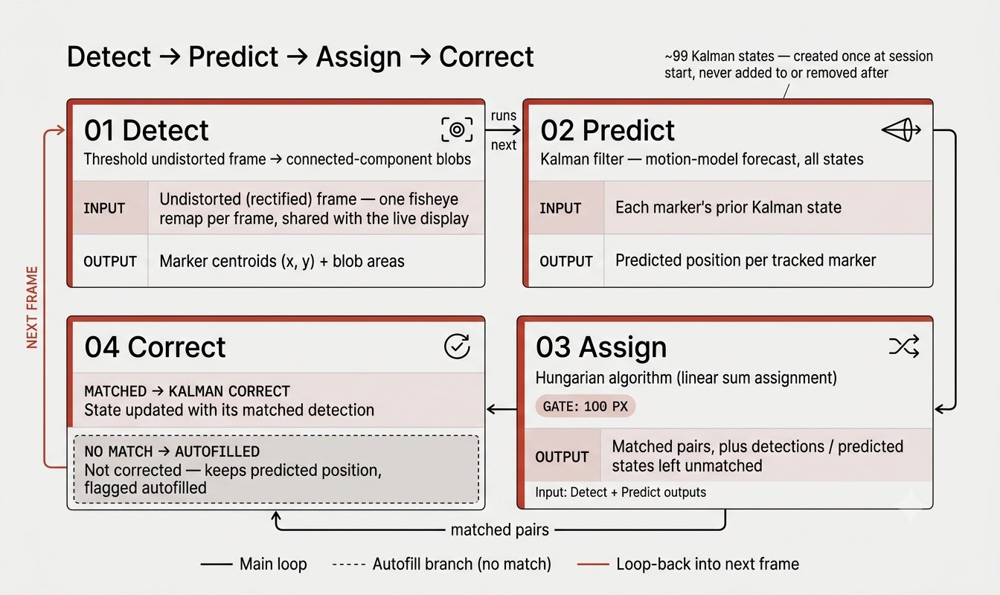

# GripVT

GripVT is a marker-displacement visuotactile sensor that estimates grip strength from musculotendon-induced skin deformation on the anterior wrist. This repository is the tracking software: it reads a 9x11 grid of 99 markers printed on the forearm, follows how each one moves relative to a captured baseline, and records that displacement per session.

<!-- TODO: screenshot of SessionWindow live feed with tracked markers -->

## How tracking works

Each frame goes through four stages, run in `core/tracker.py`, then loops back to the first for the next frame:

1. **Detect** (`core/detector.py`) - threshold the frame and find marker blobs as connected components.
2. **Predict** (`core/kalman.py`) - a Kalman filter predicts where every marker should be, one state per marker, initialized once at baseline capture and never added to or removed mid-session.
3. **Assign** (`core/hungarian.py`) - detections are matched to predicted states with `scipy.optimize.linear_sum_assignment`, gated at 100 px so a marker can't jump to a neighbor's position.
4. **Correct** (`core/kalman.py`) - each matched detection updates its Kalman state. A predicted state with no match this frame keeps its predicted position and is flagged as autofilled instead of corrected.

Displacement is always measured against the baseline frame (`dx = x_current - x_baseline`), not frame to frame. `core/tracker.py::process_frame` applies one precomputed fisheye remap to the full frame before detection, so `x`, `y`, and `area` are already geometrically corrected at the point of measurement — the same rectified frame is reused for the live display, with no second undistort pass.



## App flow

```
LandingWindow -> NewParticipantWindow -> CalibrationWindow -> SessionWindow
                \-> ResumeSessionWindow -> CalibrationWindow -^
```

`LandingWindow` offers Resume Session when a participant has an interrupted visit; picking one opens `ResumeSessionWindow`, which skips anthropometrics entry (already on disk) and continues straight to calibration for that participant.

`SessionWindow` covers the live camera feed, baseline capture, and trial recording, split into mixins under `ui/session/` (`baseline.py`, `recording.py`, `camera_feed.py`, `progress.py`, `modals.py`). Once a session reaches 30/30 trials, a post-session unmount/rest modal (`ui/session/modals.py`) prompts the operator with a soft-paced break before the next session.

## Running it

Requires Python 3.10+ and a connected camera (built for a fixed-focus 1024x768 sensor; see `calibration/intrinsics/` for the fisheye calibration used to undistort it).

```bash
pip install -r requirements.txt
python main.py
```

Session output is written to `recordings/participantNNN_<timestamp>/sessionN_<timestamp>/` as CSV and PNG; nothing is written to the project root.

## Status

- Bench characterization and its planned test suite were descoped; this is now a human-data-collection tool only.
- Detection parameters (`GATE_PX`, blob area bounds in `core/detector.py`) were tuned on a fisheye phantom-slab rig, not on real GripVT footage, so the first recording sessions will likely need retuning.
- The marker grid geometry (pitch, orientation) has not yet been fully verified against real footage.
